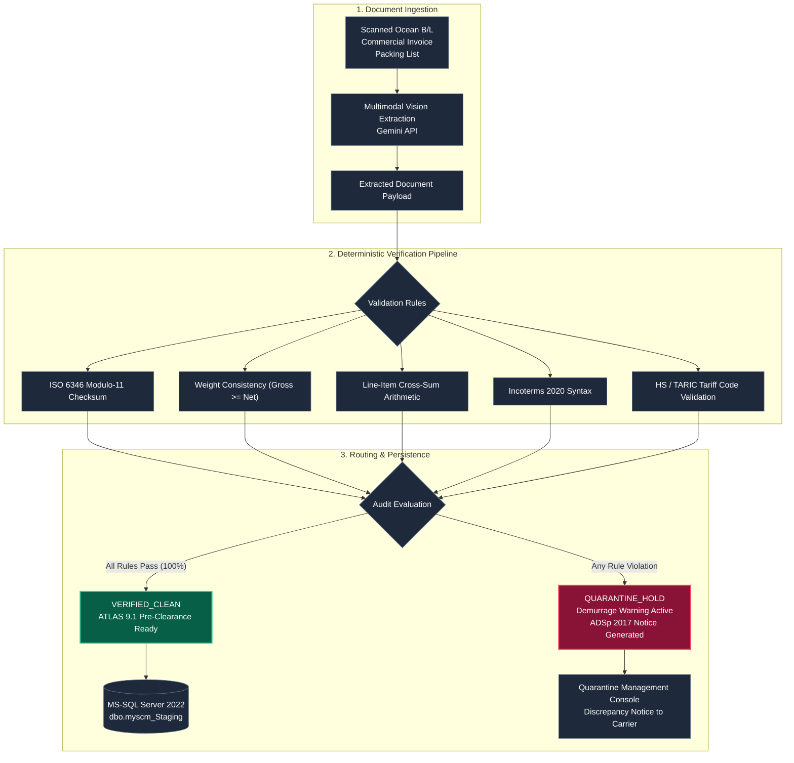

# RedLine Gateway
### Automated Shipping Document Ingestion & Customs Compliance Verification

[](https://redline-gateway.onrender.com)
[](https://redline-gateway.onrender.com/health)
[--Central-4f46e5?style=flat-square)](https://redline-gateway.onrender.com)
[](https://www.python.org/)
[](https://fastapi.tiangolo.com/)
[](https://www.docker.com/)
[](https://www.spediteure.de/adsp/)

Developed for **[Red Line Internationale Spedition GmbH](https://www.redline-spedition.de/)** & **[mw1group](https://www.mw1group.com/)**  
*Gewerbepark Kachtenhausen 1–10, 32791 Lage, Germany*

---

> **Live Service:** [https://redline-gateway.onrender.com](https://redline-gateway.onrender.com)  
> **API Documentation (OpenAPI/Swagger):** [https://redline-gateway.onrender.com/docs](https://redline-gateway.onrender.com/docs)  
> **Health Probe:** [https://redline-gateway.onrender.com/health](https://redline-gateway.onrender.com/health)

---

## 1. Overview & Operational Scope

**RedLine Gateway** is a document processing and customs validation engine designed to ingest international freight documents (Ocean Bills of Lading, Air Waybills, Commercial Invoices, and Packing Lists), extract shipment entities, and validate them against logistics standards before ERP staging and German ATLAS 9.1 customs submission.

### Operational Objectives
1. **Demurrage & Detention Prevention:** Detects weight discrepancies, invalid container check digits, and missing HS/TARIC tariff classifications before ocean vessels arrive at port (e.g., Hamburg or Rotterdam), mitigating carrier detention charges (€150–€350/day).
2. **Dispatcher Workflow Automation:** Converts unstructured PDFs and document scans into verified structured records, eliminating manual re-keying into operational systems.
3. **Deterministic Rule Enforcement:** Document parsing is coupled with strict mathematical and legal validation (ISO 6346 Modulo-11, weight consistency under § 412 HGB, line-item arithmetic). Model outputs are never committed directly to operational tables without passing deterministic verification.
4. **ERP Integration:** Emits parameterized Transact-SQL statements and JSON payloads formatted for direct ingestion into mw1group's internal `myscm` Microsoft SQL Server 2022 database and .NET backend.

---

## 2. System Architecture



---

## 3. Core Validation Modules

### Three-Way Document Reconciliation
Cross-checks the primary ocean freight document set:
* **Transport Document (B/L)** vs. **Commercial Invoice** vs. **Packing List**
* Verifies container numbers, package quantities (Colli), gross and net weights, currencies, and Incoterms across all three documents.
* Automatically routes files to quarantine if cross-document variance thresholds are exceeded (e.g., > 50 kg weight variance).

### ISO 6346 Modulo-11 Container Validation
Implements the standard ISO 6346 checksum verification for 11-character intermodal shipping containers (4-letter owner/equipment code, 6-digit serial, 1 check digit). Prevents gate-in rejections and terminal fines at container facilities (Hamburg CTA/NTB, Rotterdam World Gateway).

### Weight Consistency Verification (§ 412 HGB)
Validates that declared gross weights strictly exceed net weights across individual line items and document aggregates, adhering to shipper declaration rules under Section 412 of the German Commercial Code (HGB).

### Carrier Discrepancy Notice Generation (ADSp 2017)
When discrepancies are detected between carrier Bills of Lading and supplier commercial documents, the gateway produces a formal discrepancy memo citing **ADSp 2017 Section 19** and **§ 412 HGB**, allowing dispatchers to notify shipping lines immediately to halt demurrage accrual.

---

## 4. Technology Stack

| Component | Technology | Role |
| :--- | :--- | :--- |
| **API Framework** | FastAPI (Python 3.11) | Asynchronous REST API with Pydantic v2 validation |
| **Entity Extraction** | Google Gemini Vision API | Structured multimodal OCR and key-value mapping |
| **Validation Engine** | Pure Python | Deterministic ISO 6346, arithmetic, and trade code rule validation |
| **Persistence** | SQLite / MS-SQL Server | Local audit ledger; T-SQL bridge for myscm staging |
| **Frontend** | Single Page Application | HTML5, Tailwind CSS, vanilla JavaScript |
| **Containerization** | Docker | Multi-stage Debian-slim runtime |
| **Monitoring** | UptimeRobot | Periodic HTTP health probes |

---

## 5. Local Setup

### Prerequisites
* Python 3.11+
* Git

### Step 1: Clone Repository
```bash
git clone https://github.com/AllenFletcherAI/Redline-Gateway.git
cd Redline-Gateway
```

### Step 2: Install Dependencies
```bash
pip install -r requirements.txt
```

### Step 3: Configure Environment
Create a `.env` file in the project root:
```env
GEMINI_API_KEY="your-google-gemini-api-key"
PORT=8000
HOST=0.0.0.0
ENVIRONMENT=development
COMPANY_NAME="Red Line Internationale Spedition GmbH"
PARTNER_NAME="mw1group"
```

### Step 4: Run Application
```bash
python run.py
```
* **Web UI**: `http://localhost:8000`
* **Swagger API Docs**: `http://localhost:8000/docs`
* **Health Check**: `http://localhost:8000/health`

### Alternative: Run with Docker
```bash
docker build -t redline-gateway .
docker run -p 7860:7860 -e GEMINI_API_KEY="your-key" redline-gateway
```

---

## 6. Deployment & High Availability

The service runs on **Render** (Frankfurt, EU-Central region) with automatic builds triggered from the repository's `main` branch.

### Health Probing & Keep-Alive
* **Endpoint:** `https://redline-gateway.onrender.com/health`
* **Method:** HTTP `HEAD` / `GET`
* **Frequency:** 5-minute interval via UptimeRobot
* **Function:** Prevents container idle spin-downs on free-tier infrastructure, ensuring consistent response times.

---

## 7. REST API Reference

| Method | Endpoint | Description |
| :--- | :--- | :--- |
| `GET / HEAD` | `/` | Web application dashboard |
| `GET / HEAD` | `/health` | Service health and uptime check |
| `GET` | `/api/v1/metrics` | Processing metrics (total processed, clean count, quarantine count) |
| `POST` | `/api/v1/documents/process` | Upload document for OCR entity extraction and deterministic audit |
| `GET` | `/api/v1/sample/{doc_type}` | Pre-loaded sample transport documents for testing |
| `GET` | `/api/v1/reconcile-samples` | Three-way dossier sample set (B/L, Commercial Invoice, Packing List) |
| `POST` | `/api/v1/reconcile-simulation` | Executes cross-document reconciliation and identifies variances |
| `GET` | `/api/v1/recent` | Recent audit ledger entries |
| `POST` | `/api/v1/quarantine/override` | Records authorized supervisor release on quarantined shipment |
| `GET` | `/api/v1/integration/mssql-ddl` | MS-SQL Server DDL schema for `myscm_Staging` tables |
| `GET` | `/api/v1/integration/client-snippets` | C#, Python, and cURL client integration code snippets |

---

## 8. ERP Integration Specification (mw1group / myscm)

### Target Database Schema ([dbo].[myscm_Staging_Shipments])
```sql
CREATE TABLE [dbo].[myscm_Staging_Shipments] (
    [StagingID] INT IDENTITY(1,1) PRIMARY KEY,
    [ShipmentRef] NVARCHAR(50) NOT NULL,
    [ContainerNumber] NVARCHAR(11) NULL,
    [SealNumber] NVARCHAR(30) NULL,
    [GrossWeightKg] DECIMAL(10,2) NULL,
    [NetWeightKg] DECIMAL(10,2) NULL,
    [TotalPackages] INT NULL,
    [PackageType] NVARCHAR(50) NULL,
    [InvoiceTotal] DECIMAL(12,2) NULL,
    [CurrencyCode] CHAR(3) DEFAULT 'EUR',
    [Incoterm] CHAR(3) NULL,
    [OriginPort] NVARCHAR(50) NULL,
    [DestinationPort] NVARCHAR(50) NULL,
    [ShipperName] NVARCHAR(150) NULL,
    [ConsigneeName] NVARCHAR(150) NULL,
    [AuditStatus] NVARCHAR(30) NOT NULL,
    [AtlasReady] BIT DEFAULT 0,
    [IngestedAtUtc] DATETIME2 DEFAULT SYSUTCDATETIME()
);
```

### C# / ASP.NET Ingestion Client
```csharp
using System.Net.Http.Json;

public async Task<RedLineStagingResponse> IngestFreightDocumentAsync(byte[] documentBytes, string fileName)
{
    using var client = new HttpClient { BaseAddress = new Uri("https://redline-gateway.onrender.com") };
    using var content = new MultipartFormDataContent();
    content.Add(new ByteArrayContent(documentBytes), "file", fileName);

    var response = await client.PostAsync("/api/v1/documents/process", content);
    response.EnsureSuccessStatusCode();

    return await response.Content.ReadFromJsonAsync<RedLineStagingResponse>();
}
```

---

## 9. Security & Compliance

* **Data Privacy (GDPR / DSGVO):** Complies with European data protection standards. Document bytes are processed in memory and never retained for third-party machine learning model training.
* **Non-Root Container Security:** The Docker image runs under an unprivileged user account (`gateway`, UID `1000`) following CIS container security guidelines.
* **Audit Trail Integrity:** Ingested documents receive a SHA-256 cryptographic digest binding document content, extraction timestamps, and deterministic validation outputs.

---

## 10. License

Proprietary software developed for **Red Line Internationale Spedition GmbH** & **mw1group**. All rights reserved.
