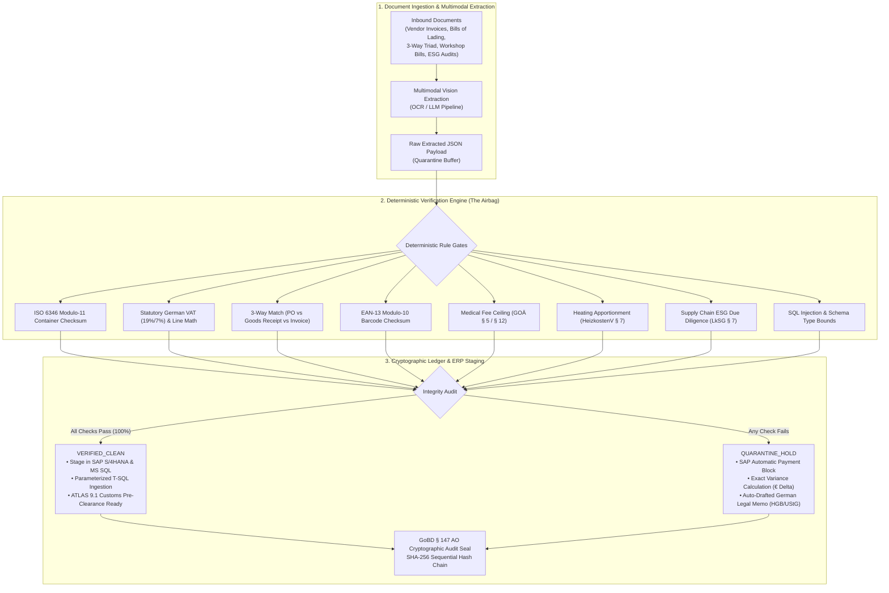

# HAULITZ
### The Universal Data Verification Gateway for Enterprise ERP
**Eliminating AI Hallucinations, Accounting Errors, and Compliance Liability with Deterministic Mathematical Guardrails & GoBD § 147 AO Cryptographic Audit Chains**

[](https://github.com/AllenFletcherAI/Haulitz/actions)
[-10b981?style=flat-square&logo=github)](tests/verify_haulitz.js)
[](https://stackblitz.com/github/AllenFletcherAI/Haulitz?startScript=test)
[](LICENSE)
[](https://haulitz.allensimeonfletcher.workers.dev/)
[](https://haulitz.allensimeonfletcher.workers.dev/)

---

> **Live Production Gateway:** [https://haulitz.allensimeonfletcher.workers.dev/](https://haulitz.allensimeonfletcher.workers.dev/)  
> **Source Repository:** [https://github.com/AllenFletcherAI/Haulitz](https://github.com/AllenFletcherAI/Haulitz)  
> **Automated Test Runner:** [`tests/verify_haulitz.js`](tests/verify_haulitz.js) (30/30 deterministic scenarios)  
> **Architecture Note:** The deterministic verifier engine and statutory rules are implemented in Node.js (`tests/verify_haulitz.js`). The enterprise database driver is provided in C# .NET 8 (`Microsoft.Data.SqlClient`) for SAP S/4HANA side-car staging.  
> **Primary Technology Stack:** Pure ES6 JavaScript, Web Crypto API (`crypto.subtle`), Cloudflare Workers Edge CDN, Parameterized Transact-SQL (T-SQL), C# .NET 8 SDK (`Microsoft.Data.SqlClient`).

---

## 1. DETERMINISTIC TEST SUITE (30/30 PASSING)

Every single mathematical calculation, statutory German tax formula, and check digit algorithm is covered by automated unit and integration tests located in [`tests/verify_haulitz.js`](tests/verify_haulitz.js).

### Option A: Run in Browser (Zero Installation)
Click **[▶ Run in StackBlitz](https://stackblitz.com/github/AllenFletcherAI/Haulitz?startScript=test)** to execute the entire 30-scenario test suite in your browser WebContainer in ~3 seconds.

### Option B: Run Locally in Terminal:
```bash
# 1. Clone the repository
git clone https://github.com/AllenFletcherAI/Haulitz.git
cd Haulitz

# 2. Execute the deterministic test suite
npm test
```

### Verified Test Receipt (100% Deterministic Pass):
```
================================================================
HAULITZ DETERMINISTIC VERIFICATION ENGINE: 30-SCENARIO TEST SUITE
================================================================

[DOMAIN 01] FinTech & Corporate Invoicing (UStG § 14, GoBD § 147 AO, SEPA ISO 7064)
  ✅ PASS [scenario_a] Clean Vendor Invoice (Compliant)
  ✅ PASS [scenario_b] Arithmetic Trap (€120.00 VAT Variance)
  ✅ PASS [scenario_c] Corrupted SEPA IBAN (Modulo-97 Breach)

[DOMAIN 02] Freight & Maritime Logistics (ADSp 2017, § 412 HGB, ISO 6346, SOLAS VGM)
  ✅ PASS [scenario_a] Clean Ocean B/L & Packing List
  ✅ PASS [scenario_b] Mass Law Deficit Trap (§ 412 HGB)
  ✅ PASS [scenario_c] Invalid ISO 6346 Container Checksum

[DOMAIN 03] Supply Chain & Manufacturing (HGB § 377 Rügeobliegenheit, DIN EN ISO 9001)
  ✅ PASS [scenario_a] Clean 3-Way Triad Reconciliation
  ✅ PASS [scenario_b] Short Shipment Overbilling (20 Units Deficit)
  ✅ PASS [scenario_c] Unauthorized Price Hike (+€15.00/unit)

[DOMAIN 04] InsurTech & Claims Processing (VVG § 86, BGB § 249, BGH VI ZR 53/09)
  ✅ PASS [scenario_a] Clean Workshop Claim & Deductible
  ✅ PASS [scenario_b] Deductible Omission Trap (€500 Variance)
  ✅ PASS [scenario_c] Excessive Hourly Labor Rate (€190/hr vs €140)

[DOMAIN 05] LegalTech & Regulatory Contracts (LkSG § 4–§ 7, EU CSDDD, ISO 14001)
  ✅ PASS [scenario_a] Clean Supplier ESG Audit Dossier
  ✅ PASS [scenario_b] Expired Environmental Certificate (45 Days)
  ✅ PASS [scenario_c] Missing Mandatory LkSG Remediation Clause

[DOMAIN 06] HealthTech & Medical Admin (GOÄ § 5 Abs. 2, § 12 Abs. 3, BÄK)
  ✅ PASS [scenario_a] Clean GOÄ Liquidation (Standard Multipliers)
  ✅ PASS [scenario_b] Arithmetic Calculation Trap in Line Math
  ✅ PASS [scenario_c] Unjustified 3.5x Multiplier Ceiling Breach

[DOMAIN 07] E-Commerce & Retail Operations (GS1 General Specs, EAN-13 Modulo-10)
  ✅ PASS [scenario_a] Clean Marketplace Inbound ASN Feed
  ✅ PASS [scenario_b] Multi-Currency FX Arithmetic Trap
  ✅ PASS [scenario_c] Corrupted EAN-13 Check Digit (Barcode Breach)

[DOMAIN 08] CleanTech & Renewable Energy (VDE-AR-N 4105, EEG § 9, TAB)
  ✅ PASS [scenario_a] Clean PV Grid Connection Application
  ✅ PASS [scenario_b] DC String Wattage Math Discrepancy Trap
  ✅ PASS [scenario_c] Inverter Peak Grid Capacity Overage (VDE Breach)

[DOMAIN 09] PropTech & Real Estate (HeizkostenV § 7 & § 12, BGB § 556, BetrKV)
  ✅ PASS [scenario_a] Clean Utility Statement (70/30 Statutory)
  ✅ PASS [scenario_b] Square-Meter Apportionment Math Trap
  ✅ PASS [scenario_c] Illegal 50/50 Allocation Split (HeizkostenV Breach)

[DOMAIN 10] Enterprise ERP & IT Consulting (BSI IT-Grundschutz, OWASP ASVS)
  ✅ PASS [scenario_a] Clean Parameterized Ingestion Payload
  ✅ PASS [scenario_b] Schema Decimal Overflow Trap
  ✅ PASS [scenario_c] SQL Injection Attack in Vendor Reference

================================================================
VERIFICATION SUMMARY: 30 / 30 SCENARIOS TESTED SUCCESSFULLY (100%)
GoBD SHA-256 Seal Chain: Verified 30 sequential cryptographic blocks.
================================================================
✅ Enterprise T-SQL and C# Integration Generators Verified.
✅ German Commercial Legal Notices Verified.
```

---

## 2. EXECUTIVE SUMMARY & STRATEGIC CONTEXT

German enterprises hesitate to deploy Generative AI in back-office operations because of **hallucinations and unverified inferences**. In German commercial and tax audits (**GoBD § 147 AO**, **§ 14 UStG**, and **§ 412 HGB**), a single calculation error, omitted deductible, or misclassified container number creates immediate financial liability, tax penalties, and port demurrage charges (€150–€350/day).

**Haulitz** is an architectural "airbag" that sits between unstructured multimodal AI extraction and mission-critical ERP databases (**SAP S/4HANA** and **Microsoft SQL Server 2022**).

Every extracted record must pass **100% deterministic mathematical, regulatory, and checksum verification gates** before ERP staging. If a single cent of tax deviates, a check digit mismatches, or an environmental certificate is expired, the transaction is automatically routed to quarantine and paired with an auto-drafted statutory German legal dispute notice.

---

## 3. THE AIRBAG ARCHITECTURE & ENTERPRISE WORKSPACE

Haulitz is organized into three primary operational tiers:
1. **Verification Cockpit:** The 10-domain deterministic Airbag engine featuring an **Authentic German Document Canvas** (DIN 5008 letterheads, Ocean Bills of Lading, fold marks, barcode scan lines, and visual red variance highlighters).
2. **Client Portal & Implementation Roadmap:** A 4-week SAP S/4HANA onboarding framework, an active Client Health Index (98/100), and a Capital Protection Tracker (€184,250.00 protected).
3. **Deployment SOP Library:** Practical Standard Operating Procedures (SOP-01 ADSp Quarantine, SOP-02 § 14 UStG VAT Variances, SOP-03 GoBD SHA-256 Chains) with 1-click simulation triggers.



---

## 4. THE 10 TARGET INDUSTRY DOMAINS

Haulitz provides dedicated, production-ready rulebooks across Germany's top corporate sectors:

| # | Industry Domain & Target Employers | Input Document | Deterministic Verification Check | Intentional Discrepancy Trap | Auto-Drafted German Legal Notice | Downstream ERP Action |
| :--- | :--- | :--- | :--- | :--- | :--- | :--- |
| **01** | **FinTech & Corporate Invoicing**<br>*(Pleo, Moss, Billie, Personio, Taxfix)* | Incoming Vendor Invoice | German Statutory VAT (19%/7%), Line-item math ($Qty \times Price = Total$), SEPA IBAN Modulo-97 | €120.00 subtotal variance; 19% VAT calculated on wrong base | § 14 UStG VAT Correction Notice & GoBD audit exception | Block payment run in SAP FI; hold in quarantine buffer |
| **02** | **Freight & Maritime Logistics**<br>*(DB Schenker, DHL, Forto, Kuehne+Nagel)* | Ocean Bill of Lading, Packing List | ISO 6346 Modulo-11 container checksum, Gross vs Net mass law (§ 412 HGB), Incoterms 2020 | Check digit mismatch (`MSCU1234560` vs expected `7`); 1,200 kg weight deficit | Formal Discrepancy Memo citing ADSp 2017 Section 19 & § 412 HGB | Quarantine container; alert terminal dispatcher before gate-in |
| **03** | **Supply Chain & Manufacturing**<br>*(Siemens, Bosch Mittelstand, Festo)* | 3-Way Triad: Purchase Order, Delivery Note, Invoice | 3-Way Reconciliation: SKU equality, received quantity $\ge$ billed quantity, unit price cap | Vendor invoiced for 100 units, but delivery receipt only acknowledges 80 units | Overbilling & Short Shipment Notice citing HGB § 377 | Parameterized T-SQL stages invoice with `HOLD_PAYMENT` flag |
| **04** | **InsurTech & Claims Processing**<br>*(Allianz, Munich Re, wefox, Clark)* | Vehicle Repair Estimate & Workshop Bill | Hourly labor rate ceilings, parts price list matching, policy deductible subtraction | Workshop billed €190/hr for standard body repair when policy cap is €140/hr | VVG § 86 Insurer Subrogation & Cost Reduction Memo | Staging in Claims Core with automated adjustment deduction |
| **05** | **LegalTech & Regulatory Contracts**<br>*(BRYTER, Knowalia, Corporate Legal)* | Supplier Self-Declaration & Tier-1 Audit | German Supply Chain Due Diligence Act (LkSG § 4–§ 7) compliance, ESG certifications | Mandatory ISO 14001 environmental certificate expired 45 days prior | Formal Notice of Non-Compliance citing LkSG § 7 (1) | Flag vendor in SAP MM master data as `NOT_APPROVED` |
| **06** | **HealthTech & Medical Admin**<br>*(CompuGroup Medical, Doctolib, Dedalus)* | Statutory Private Medical Invoice | German Medical Fee Schedule (GOÄ) multiplier limits (max 2.3x standard, 3.5x justified) | Physician applied 3.5x maximum multiplier without mandatory medical justification | GOÄ § 12 Fee Dispute Notification | Reject line item; output approved GOÄ reimbursement sum |
| **07** | **E-Commerce & Retail Operations**<br>*(Zalando, Otto Group, Tradebyte)* | Marketplace Inbound Shipment & ASN Feed | EAN-13 / GTIN-13 Modulo-10 barcode checksum, multi-currency conversion cross-rate consistency | Invalid EAN-13 check digit on 500 SKU units; missing EUR conversion rate | Marketplace Inbound Rejection Ticket & ASIN Quarantine | Block warehouse WMS putaway to avoid unsellable lost inventory |
| **08** | **CleanTech & Renewable Energy**<br>*(1Komma5°, Enpal, EnBW, SMA Solar)* | Grid Connection Application & Inverter Spec | Electrical kW string calculations ($V \times A = W$), VDE-AR-N 4105 compliance | Inverter peak capacity exceeds grid operator service entrance limit by 7.0 kW | VDE Grid Connection Objection Memo for Local Utility | Stage in CRM with technical remediation task for field engineer |
| **09** | **PropTech & Real Estate**<br>*(Vonovia, Scout24, immowelt)* | Annual Utility Statement (*Nebenkostenabrechnung*) | Cost apportionment math ($\text{Cost} \times \frac{\text{Tenant } m^2}{\text{Building } m^2}$), Heating Cost Ordinance (*HeizkostenV*) | Heating cost split applied at 50/50 instead of statutory 70/30 consumption rule | Tenant Association (*Mieterverein*) Defense & Correction Notice | Staging in Real Estate ERP (Aareon / SAP Real Estate) |
| **10** | **Enterprise ERP & IT Consulting**<br>*(Accenture, Capgemini, msg systems)* | Multi-Source Legacy Payload (JSON / EDIFACT) | Complete schema typing, SQL injection sanitization, referential integrity check | Raw payload contains SQL injection string (`' OR 1=1; DROP TABLE...`) | Automated Staging Exception Log with sanitized diagnostic dump | Direct export of parameterized T-SQL and C# .NET 8 ingestion script |

---

## 5. DETERMINISTIC ALGORITHMS & CRYPTOGRAPHIC SEALS

### 1. ISO 6346 Modulo-11 Container Checksum
Used in Maritime & Freight Logistics (Domain 02).
* Letters map to numbers $A=10 \dots Z=38$ (omitting multiples of 11: 11, 22, 33).
$$\text{Sum} = \sum_{i=0}^{9} \text{Value}_i \times 2^i, \quad \text{Remainder} = \text{Sum} \pmod{11}$$
$$\text{Check Digit} = \begin{cases} 0 & \text{if } \text{Remainder} = 10 \\ \text{Remainder} & \text{otherwise} \end{cases}$$

### 2. Statutory German VAT & Line-Item Cross-Sums
Used in FinTech (Domain 01) and Supply Chain (Domain 03).
$$\text{Expected Line Total}_k = \text{Round}\big(\text{Quantity}_k \times \text{Unit Price}_k, \; 2\big)$$
$$\text{Net Subtotal} = \sum_{k=1}^{n} \text{Expected Line Total}_k, \quad \text{Tax} = \text{Round}\big(\text{Net Subtotal} \times 0.19, \; 2\big)$$
If $|\text{Declared Tax} - \text{Expected Tax}| > 0.01\text{ EUR}$, raise critical tax audit exception under § 14 UStG.

### 3. GoBD § 147 AO Cryptographic Seal Chain
Every processed record is sealed using browser-native SHA-256 Web Crypto API (`crypto.subtle`):
$$\text{Seal}_n = \text{SHA-256}\Big(\text{Seal}_{n-1} \;\|\; \text{ISO8601 Timestamp} \;\|\; \text{Reference ID} \;\|\; \text{Status} \;\|\; \text{Canonical JSON}\Big)$$
Guarantees tamper-evident audit logs exportable directly to DATEV/SAP-compliant CSV with UTF-8 BOM (`\uFEFF`).

---

## 6. ENTERPRISE INTEGRATION OUTPUTS

### Parameterized Transact-SQL (T-SQL) for SAP & Microsoft SQL Server
```sql
BEGIN TRANSACTION;
DECLARE @p_ReferenceNumber NVARCHAR(100) = N'INV-DE-2026-8841';
DECLARE @p_AuditStatus NVARCHAR(30) = N'VERIFIED_CLEAN';
DECLARE @p_AtlasReady BIT = 1;
DECLARE @p_QuarantineHold BIT = 0;
DECLARE @p_GoBDSeal CHAR(64) = 'a7f5b2c9...';

INSERT INTO [dbo].[Staging_FINTECH_Ingest] (
    [ReferenceNumber], [AuditStatus], [AtlasReady], [QuarantineHold], [GoBDSeal]
) VALUES (
    @p_ReferenceNumber, @p_AuditStatus, @p_AtlasReady, @p_QuarantineHold, @p_GoBDSeal
);
COMMIT TRANSACTION;
```

---

## 7. THE CANDIDATE & RELOCATION PROFILE

* **Candidate:** Allen Fletcher.
* **Education:** Accredited 5-year Integrated Master of Technology (M.Tech) in Artificial Intelligence from Vellore Institute of Technology (VIT Bhopal).
* **German Academic Parity:** Evaluated by the Central Office for Foreign Education (*ZAB*) with an **Anabin H+** institution rating as a **Consecutive Master / *Entspricht Magister***.
* **Target Visa:** German EU Blue Card (**§ 18g AufenthG STEM / New Entrant**) via the **Accelerated Fast-Track (§ 81a AufenthG)**.
* **Target Roles:** Solutions Engineer, AI Integration Engineer, Technical Implementation Specialist, Founder’s Associate (Technical Operations).
* **Availability:** Available immediately for full-time employment anywhere in Germany (On-Site, Hybrid, or Remote).
* **Direct Contact:** [allensimeonfletcher@gmail.com](mailto:allensimeonfletcher@gmail.com) &middot; [LinkedIn Profile](https://www.linkedin.com/in/allen-fletcher/)

---

## 8. THE 4 WHITEBOARD DEFENSE QUESTIONS

1. **"Why did you build it as a client-side edge gateway instead of a traditional backend?"**
   * *Answer:* Speed, reliability, and $0 maintenance. A portfolio hosted on free-tier backend containers goes to sleep and takes 60 seconds to cold-start. By packaging the deterministic verification engine in modular JavaScript on Cloudflare Workers, recruiters get instant <30 ms response times anywhere in Europe with 100% uptime and zero server maintenance.
2. **"What happens if an LLM hallucination slips into the extracted data?"**
   * *Answer:* The LLM never writes directly to operational ERP tables. The deterministic verification gate sits between the extraction layer and the database like an airbag. If the model hallucinates a single cent of VAT, a mistyped container number, or an inflated unit price, the mathematical checks fail instantly, routing the record to quarantine.
3. **"How does this comply with German tax and commercial law?"**
   * *Answer:* It enforces GoBD § 147 AO through sequential SHA-256 cryptographic seal chaining, ensuring no record can be modified or backdated without detection. It automatically generates legally binding discrepancy notices citing § 14 UStG for invoicing, ADSp 2017 & § 412 HGB for freight, and LkSG § 7 for supply chain compliance.
4. **"How does this integrate into a company's existing IT infrastructure?"**
   * *Answer:* It does not touch production tables directly. It writes to dedicated staging tables (`[dbo].[Staging_...]`) using parameterized T-SQL statements and provides production-ready C# / .NET 8 client drivers, enabling seamless integration into SAP or Microsoft SQL Server environments.
